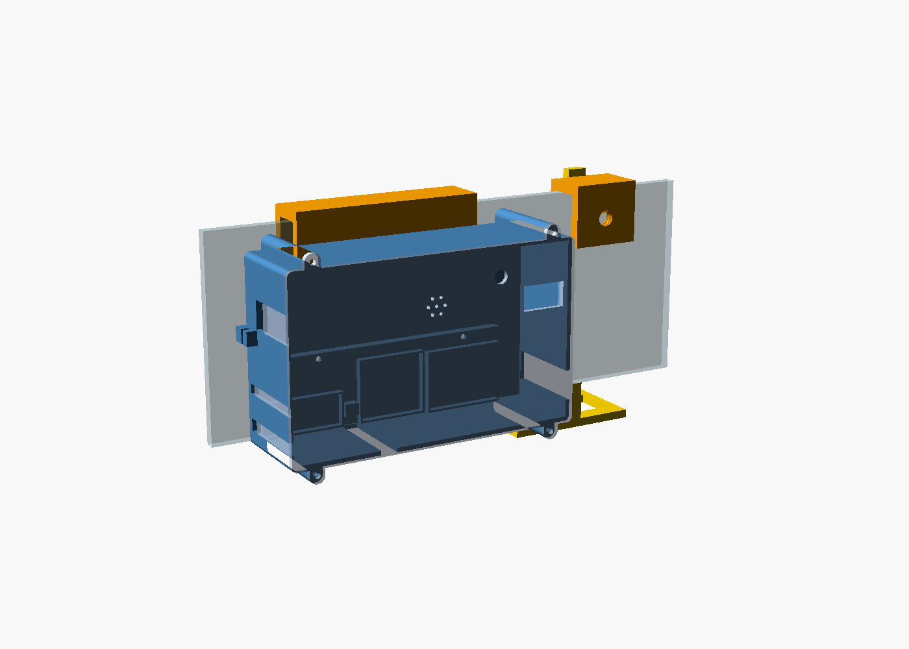

# Caixa impressa em 3D do nó sensor

Caixa para a bancada do nó (protoboard inteira dentro), pendurada por fora do aquário,
mais um suporte que segura as três sondas dentro da água. Impressora: Bambu Lab A1 mini.
Filamento: PETG.



## Peças

| Arquivo (`stl/`) | O que é | Quantas |
|---|---|---|
| `base.stl` | fundo e paredes da caixa | 1 |
| `tampa.stl` | frente com janela do OLED, furo do LED e grade do buzzer | 1 |
| `gancho.stl` | presilha que pendura a caixa no vidro | 1 |
| `parafuso.stl` | parafuso de aperto (gancho e suporte) | **4** |
| `suporte_presilha.stl` | presilha do suporte, do lado de dentro do vidro | 1 |
| `suporte_braco.stl` | braço que desce até a água, com a cabeça das sondas | 1 |
| `prova_*.stl` | pedaços de teste, para conferir as folgas antes | 1 de cada |

Para comprar: **4 parafusos M3 × 10 mm** (cabeça panela), **2 parafusos M3 × 6 mm**
(prendem a caixa no gancho), abraçadeiras de nylon pequenas e sachês de sílica.

## Mesas prontas (`mesas/`)

Cada `.stl` é uma mesa inteira da A1 mini, com as peças já arrumadas dentro do mesmo arquivo:

| Arquivo | Peças | Borda (brim) |
|---|---|---|
| `0-provas-opcional.stl` | as 4 provas + 1 parafuso | não |
| `1-base-e-parafusos.stl` | base + 4 parafusos de aperto | não |
| `2-gancho-e-suporte.stl` | gancho + braço + presilha do suporte | **sim** |
| `3-tampa.stl` | tampa | não |

A base e a tampa ocupam quase a mesa inteira cada uma, então 3 mesas é o mínimo. Arraste o
`.stl` para o Bambu Studio: as peças entram juntas, como um objeto só, já na posição
certa. Não gire nem separe. Os ajustes de
impressão são os mesmos da seção abaixo. Depois de mudar `medidas.scad`, rode
`gerar.ps1` e então `python montar_mesas.py` para refazer as mesas.

## Imprimir no Bambu Studio

1. Arraste o `.stl` para dentro do Bambu Studio. **Não gire a peça**: ela já está na
   posição certa para imprimir sem suporte.
2. Filamento: **Generic PETG**. Placa: a texturizada (PEI) que vem com a A1 mini.
3. Processo: **0.20 mm Standard**, e na aba de resistência: **3 paredes**, preenchimento
   **20%** (gyroid). Suporte: **desligado**.
4. Para `gancho.stl` e `suporte_presilha.stl` (peças altas e estreitas), ligue a **borda
   (brim)** para não tombarem.
5. "Fatiar" e depois "Imprimir".

## Ordem recomendada

1. **Provas primeiro** (poucos minutos cada):
   - `prova_tampa`: o OLED tem que encaixar na moldura e a tela aparecer inteira na janela;
   - `prova_base`: um parafuso M3 tem que enroscar firme no furo da orelha;
   - `prova_gancho` + 1 `parafuso`: o parafuso tem que girar na rosca sem travar e
     apertar numa tábua ou vidro de 4 a 15 mm;
   - `prova_suporte`: o eletrodo do pH passa no furo grande e para na parte grossa; a
     sonda de temperatura entra justa no furo pequeno; o corpo da turbidez passa no
     retângulo e a tampa azul apoia por cima.
2. Se algo ficou justo ou folgado demais, conte quanto (ex.: "o OLED não entra, falta
   1 mm"). A medida muda em `medidas.scad` e as peças são geradas de novo.
3. **Peças finais**: as mesas 1, 2 e 3 de `mesas/`, nessa ordem. Mesmo mandando tudo de
   uma vez, a mesa 2 (com o gancho) tem que estar pronta antes da montagem, porque o
   gancho é parafusado por dentro da caixa vazia.

## Montar

0. **Antes de tudo**, com a caixa vazia: prenda o gancho nas costas com os 2 M3 × 6,
   enfiados por dentro da caixa. Depois que as placas estiverem lá dentro, não dá mais
   para alcançar esses furos.
1. Cole a protoboard no fundo da base, apoiada na aba comprida (a fita dupla face dela
   já vem embaixo). ESP32 do lado esquerdo, com o USB saindo pelo recorte da esquerda.
2. Encaixe relé, placa da turbidez e placa do pH nos berços de baixo, com um pedaço de
   fita dupla face. O plugue do pH sai pelo recorte da direita.
3. Passe os cabos pelas fendas: temperatura e aerador pela esquerda, turbidez por baixo.
   Prenda cada um com abraçadeira na âncora mais próxima, e o cabo USB na âncora de fora,
   à esquerda.
4. Dobre os jumpers em feixes e prenda com abraçadeira, sem puxar nenhum do furo.
5. Cole o OLED na moldura por dentro da tampa e coloque o sachê de sílica no bolso.
6. Feche a tampa com os 4 M3 × 10.
7. (O gancho já foi preso no passo 0.)
8. Pendure no vidro e aperte os 2 parafusos de aperto do lado de dentro do aquário.
9. Prenda a presilha do suporte no vidro, passe o braço na guia, ajuste a altura (a tampa
   azul da turbidez ~1 cm acima da água) e trave com o parafuso.

⚠️ Nada de 220 V dentro desta caixa.

## Medidas que ainda são estimativa

Em `medidas.scad`, marcadas com `estimado`. As que mais importam:

- **posição do LED** (`led_pos`) e do **buzzer** (`buzzer_pos`): medir na protoboard, a
  partir do canto de baixo à esquerda;
- **altura e posição do conector USB** do ESP32;
- **seção do corpo transparente da turbidez** (`turb_corpo`), abaixo da tampa azul;
- **diâmetro do plugue metálico do pH** (`ph_plugue_d`).

## Gerar de novo

```powershell
powershell -ExecutionPolicy Bypass -File gerar.ps1        # todas as peças
powershell -ExecutionPolicy Bypass -File gerar.ps1 tampa  # só uma
python verificar.py                                       # cabe na mesa e apoia em z = 0
```

Precisa do OpenSCAD 2021.01 (`winget install OpenSCAD.OpenSCAD`).
